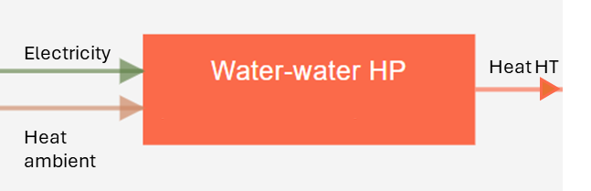
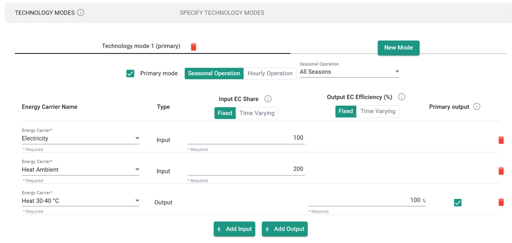
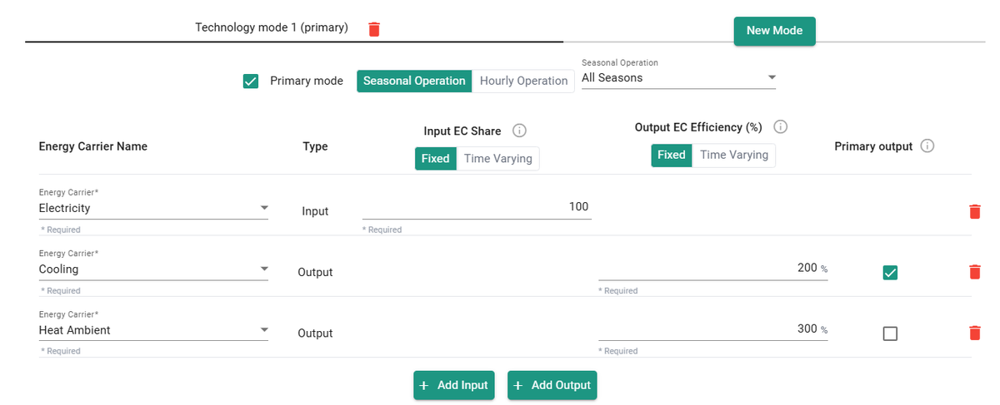
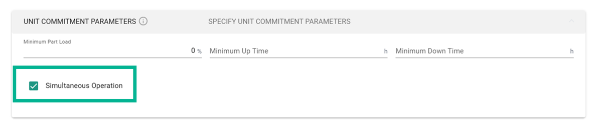
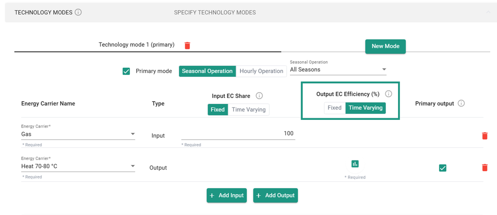
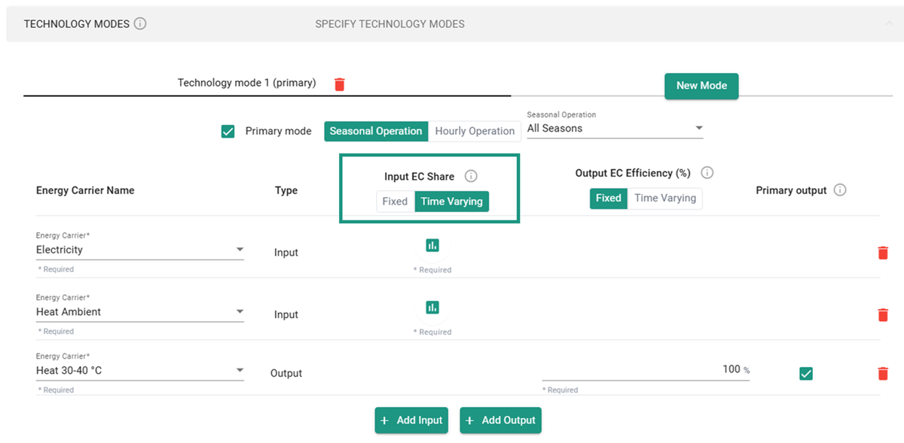
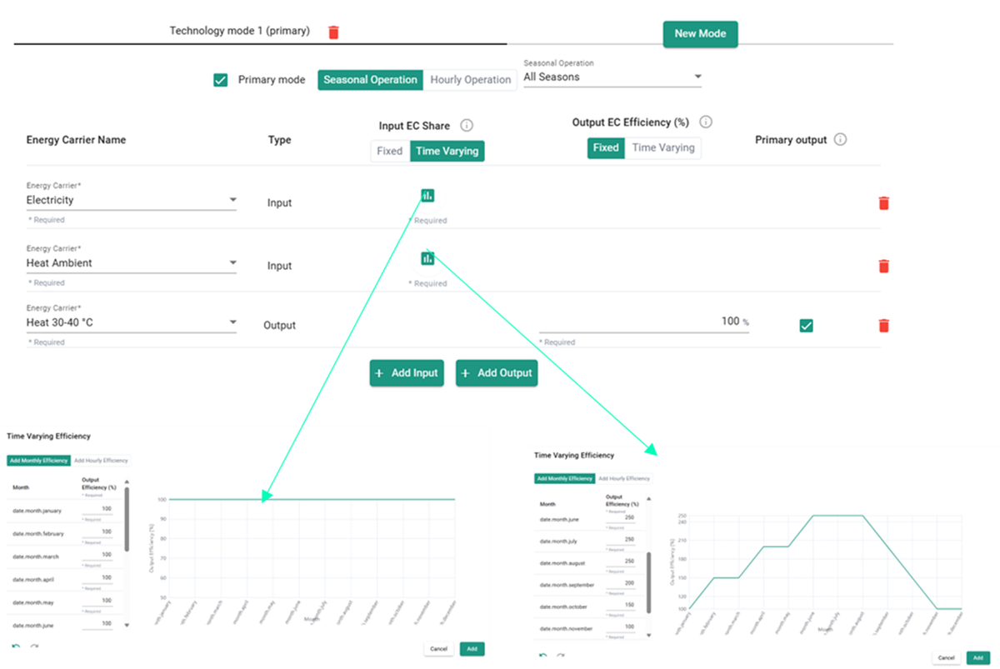

---
tags:
  - web-app
  - concepts
---

# Conversion technologies

Conversion technologies are systems that transform one or more energy carriers into different types. For example, a gas boiler converts natural gas to heat. Each technology is defined by:

- **Technical parameters**: efficiencies and technical limits.
- **Financial and environmental parameters**: investment costs (CAPEX), operational costs (OPEX), and embodied emissions.

For parameters, see
[Conversion technology parameters](../parameters/conversion-technologies.md).

## Technology modes

A mode represents a specific operational regime with its own set of inputs, outputs, and efficiencies. A single technology can have multiple modes to reflect different operating regimes.

**Example**: a reversible heat pump has a heating mode and a cooling mode, each with a distinct coefficient of performance (COP). Only one investment is made and two behaviours are possible.

!!! tip
    **Technical parameters** such as efficiency and capacity only affect the mode they are assigned to. **Financial and environmental parameters** affect all of the modes of the technology.

## Primary vs. non-primary modes

- **Primary mode**: has an impact on the installed capacity of the technology, which is reflected in the costs and CO2 emissions.
- **Non-primary mode**: does not affect the installed capacity of the technology. The technology's investment or operational costs, or its CO2 emissions are not affected by the capacity of non-primary modes.

!!! tip
    In most multi-mode use cases, each mode should be set as a primary mode.

## Mode capacity

Each mode has its own installed capacity. **Specify capacity** fixes it, a **minimum capacity** is a lower bound and a **maximum capacity** an upper bound. This applies to primary and non-primary modes. The minimum part load, the allowed operation profile and the curtailment limitation all refer to this installed mode capacity.

The technology capacity is derived from the primary modes (see [Technology capacity](#technology-capacity)). With a single primary mode, the mode and technology capacity are the same.

In each hour, a mode can produce up to its installed capacity × allowed operation × peak power. So the installed capacity can differ from the highest output in the results:

- **Peak power**: with a peak power of 1.2, a peak output of 120 kW needs 100 kW of installed capacity.
- **Hourly operation profile**: if the profile allows 50% in an hour where the mode produces 100 kW, the installed capacity must be at least 200 kW, even if 100 kW is the highest output of the year.

You can choose different sizing methods:

- **Optimize capacity**: Sympheny finds the optimal capacity.
- **Minimum and Maximum capacity**: You can enter a minimum and/or maximum capacity bound.
- **Can be installed and Minimum capacity**: If a minimum capacity is specified and the default option  is toggled, the installed capacity can either be 0 or greater than the minimum.
- **Must be installed and Minimum capacity**: The capacity must be greater than or equal to the minimum capacity.
- **Specify capacity**: The installed capacity is fixed. If the default "can be installed" option is toggled, the capacity will be either 0 or the specified capacity.

!!! note
    Operating capacity (which does not influence investment costs) can be lower than the installed capacity, or higher if the peak power is above 1. In the results, the mode **Capacity (kW)** is the installed capacity of the mode, and the capacity factor is relative to it. Modes that consume no energy are not shown in the operation results.

!!! tip
    For more advanced users, specifying a minimum and maximum capacity is good practice and often reduces computation time.

## Technology capacity

The installed capacity of the technology is used to calculate the investment, maintenance costs, and embodied emissions. It is expressed in kW-output. The technology capacity is the largest of:

- the maximum of the hourly sum of all primary outputs of all primary modes,
- the installed capacity of each primary mode,
- the largest minimum or specified capacity of the primary modes.

The technology capacity is at most the largest maximum or specified capacity of its primary modes (no upper limit if a primary mode is optimised without a maximum). Primary modes running at the same time share this capacity. Non-primary modes do not affect the technology capacity and their capacity is not paid for.

Each mode's output is divided by its peak power before it is added to the hourly sum (see [Mode capacity](#mode-capacity)).

### Example calculation

Modes A and B are both primary modes.

- **Mode A peak**: 100 kW at hour 5.
- **Mode B peak**: 200 kW at hour 10.
- **Mode A + Mode B peak**: at hour 8, modes A and B produce a combined 250 kW.

**Result**: with optimised mode capacities, the technology capacity is 250 kW.

If mode A is specified at 100 kW and mode B at 200 kW, the technology capacity is 200 kW and modes A and B can produce at most 200 kW together in any hour.

## Mode efficiency

The efficiency of a mode indicates energy dissipation within systems. The sum of output efficiencies represents the mode's total efficiency:

- A total efficiency of 100% means useful energy is conserved.
- A total efficiency below 100% indicates useful energy is lost in the system, for example heat losses in the technology, which are not modelled as a "waste heat" flow.
- A total efficiency above 100% indicates useful energy is created within the system, for example useful heat extracted from the environment, which is not modelled as an "ambient air" flow.

### Example: heat pump

The efficiency of a standard input (with two inputs) is set as follows:

| Input EC       | Input share | Output EC | Output efficiency [%] |
| -------------- | ----------- | --------- | ---------------------- |
| Electricity     | 100         | HT heat   | **100**                |
| Ambient heat    | 200         |           |                        |

The calculation is:

**Output EC(i) = Sum of inputs × efficiency output(i)**

**HT heat = (100 + 200) × 100% = 300**

In this case, 100 units of electricity and 200 units of ambient heat produce 300 units
of HT heat. This corresponds to a COP of 3 (yearly average). See illustration below on how to set these parameters in the web-app.

### Example: chiller

For chillers, there are two ways to model cooling energy. The first method treats cooling energy as a service, meaning the energy is generated and supplied. For example, when modelling a chiller with an energy efficiency ratio (EER) of 2, the process is as follows:

| Input EC    | Input share | Output EC | Output efficiency [%] |
| ----------- | ----------- | --------- | ---------------------- |
| Electricity | 100         | HT heat   | 300%                   |
|             |             | Cooling   | 200%                   |

This means that an input of 100 units of electricity produces 200 units of cooling (based on an EER of 2) and 300 units of heating (assuming the electricity is fully dissipated as heat).

100 units of electricity give, in this case, 300 units of HT heat and 200 units of cooling, from which an EER of 2 is calculated. Here, the cumulative output efficiency is greater than 100%, which reflects the "creation" of energy because cooling energy is treated as an additional service. See illustration below on how to set these parameters in the web-app.

### Alternative method: chiller

There's also an alternative method where cooling energy is treated as an extraction of energy demand. To use this method, set the cooling demand to "reversed." In this case, the chiller can be modelled as a heat pump with an EER of 2 (or a COP of 3).

| Input EC    | Input share | Output EC | Output efficiency [%] |
| ----------- | ----------- | --------- | ---------------------- |
| Electricity | 100         | HT heat   | 100%                    |
| Cooling     | 200         |           |                        |

See illustration below on how to set these parameters in the web-app.

!!! tip
    For this method, it's crucial that the **reverse** box is ticked for the cooling demand in the Energy Demands step. This treats cooling as an extraction of heat.

## Simultaneity of operation

Modes can run at the same time unless simultaneous operation is turned off.

For modes that cannot physically run together (for example heating and cooling of a reversible heat pump), leave the **simultaneous** checkbox unchecked on one or more of them. Capacity settings alone do not prevent it. Turning off simultaneous operation may increase optimisation time.

Alternatively, a less computationally intensive option is to define a different [seasonal or hourly operation](#seasonal-and-hourly-parameters) for each mode.

Some advanced parameters are not available to all plan tiers, but can be added through add-on options. Contact customer support for a demo and to discuss customising these
options to your needs.

!!! note
    Primary modes running at the same time share the technology capacity. Each running mode must produce at least its minimum part load × its own mode capacity. If these minimum outputs together exceed the technology capacity, the modes cannot run in the same hour. For example, with a technology capacity of 200 kW and two primary modes of 200 kW each with a 60% minimum part load, the modes need at least 240 kW together, so they never run at the same time.

## Resource-driven technologies

Technologies using an **Available Resource Area (m²)** or **Available Peak Load (kWp)** [on-site resource](on-site-resources.md) (for example PV or wind) must take all of the resource on their share in every hour. A minimum part load on such a mode, or a minimum up or down time, can only be met if the weakest non-zero resource hour reaches it. Otherwise the technology produces nothing.

If a technology downstream has a minimum part load (for example an inverter fed only by PV), allow curtailment on the resource technology (curtailment limitation below 100%), or add a storage or export, so hours with little resource can be dumped.

## Seasonal and hourly parameters

You can enter time-varying efficiencies, either as monthly or hourly values. To do so, select **Time varying** instead of **Fixed** for the output EC efficiency.

### Example: air-source heat pump

For heat pumps, if you want to apply a time-varying COP, modify the input EC share rather than the output efficiency. The input EC share is what defines the [COP](#example-heat-pump) (= heat HT / electricity). See the example below:

| | Jan | Feb | Mar | Apr | May | Jun | Jul | Aug | Sep | Oct | Nov | Dec |
| --- | --- | --- | --- | --- | --- | --- | --- | --- | --- | --- | --- | --- |
| Electricity | 100 | 100 | 100 | 100 | 100 | 100 | 100 | 100 | 100 | 100 | 100 | 100 |
| Heat ambient | 100 | 150 | 150 | 200 | 200 | 250 | 250 | 250 | 200 | 150 | 100 | 100 |
| HT heat | 100% (stays fixed) | | | | | | | | | | | |
| COP | 2 | 2.5 | 2.5 | 3 | 3 | 3.5 | 3.5 | 3.5 | 3 | 2.5 | 2 | 2 |

