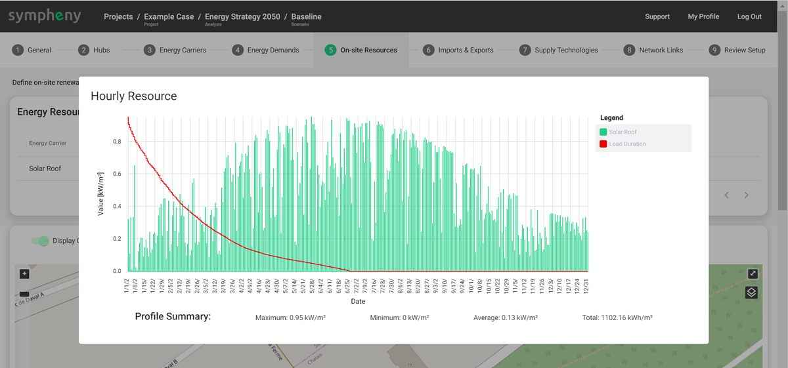

---
tags:
  - web-app
  - concepts
---

# On-site resources

On-site resources are renewable resources with intermittent (temporally varying) availability. In Sympheny, you can quickly generate solar irradiance profiles and wind profiles of 8,760 time steps using several methods.

On-site resources are functionally identical to imports, with fewer available parameters. For resources with constant availability, like geothermal energy or air used in a heat pump, create an import with a fixed maximum capacity (kW) and without an energy price (CHF/kWh), instead of creating an on-site resource.

For **Available Resource Area (m²)** and **Available Peak Load (kWp)** resources, Sympheny optimises how much of the resource to use: the area (m²) or the peak load (kWp), up to the available amount. Once chosen, this amount is fixed for the stage, and the technologies that consume it must take the full resulting profile in every hour. If this produces more energy than is needed for demand, storage and exports, the surplus can be curtailed on the technology's output (for example the electricity of a PV system), but only if you allow it with a curtailment limitation below 100%. The default of 100% allows no curtailment.

**Generic Availability (kWh/h)** resources are an upper limit: technologies can use any amount up to the profile in each hour.

See [Resource-driven technologies](conversion-technologies.md#resource-driven-technologies) for how this affects a minimum part load.
