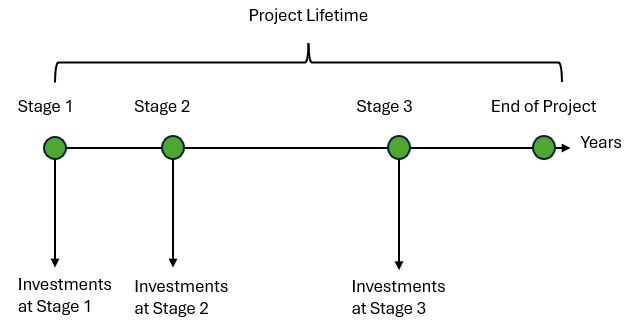

---
tags:
  - web-app
  - concepts
---

# Stages

For large projects, like the construction of a new neighbourhood, there may be an evolution in energy demands (new buildings, more EVs) and available resources (less reliance on fossil fuels). With stages, you can take these changes into account and plan the optimal energy system and network across decades.

Sympheny may choose to install technologies at the start of a stage and salvage them at the end of the stage, or reuse the technologies in the next stage. The design and operation stay the same within a stage. For parameters, see [Stages parameters](../parameters/stages.md).

The rules below apply to [conversion technologies](conversion-technologies.md) and [storage technologies](storage-technologies.md) per hub, and to [network links](network-technologies.md) per link.

## Installation and phase-out

- A technology can be installed in any stage. Its capacity can stay the same or increase in later stages.
- It can be phased out only once per hub (per link for networks). At that point all its capacity is phased out together, and it cannot be installed again in that hub.

## Replacement and salvage

- If the technology's lifetime is shorter than the period it is installed for, it is replaced after each lifetime, at replacement cost.
- When capacity is phased out, the value of its remaining lifetime is credited as salvage revenue at the end of the phase-out stage. Capacity kept until the end of the last stage receives its salvage value there.
- A technology that is only available in some stages must be phased out at the end of its last stage, so it receives its salvage value at that point. Installing a different technology in the next stage is a new investment.

!!! note
    Sympheny uses discounted cash flow (DCF) analysis to convert the total cost (represented by the net present cost, NPC) into an annual cost. See [Discounted cash flow analysis](discounted-cash-flow-analysis.md) for details.
